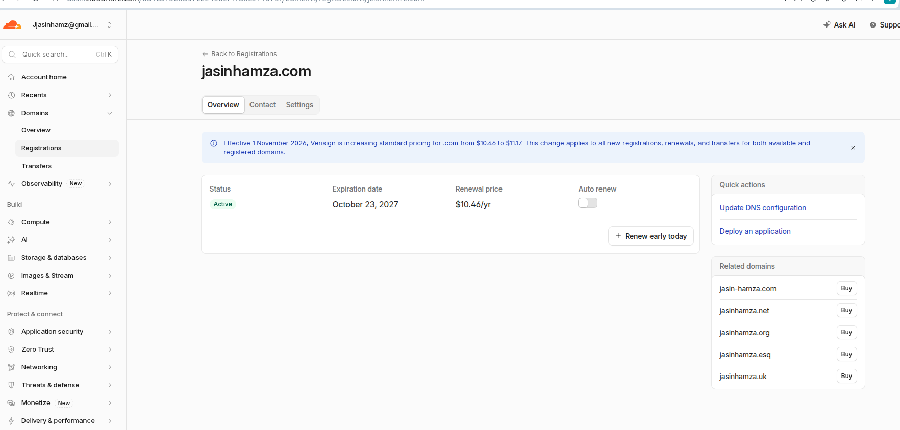

# Networking assignemnt: Domain to NGINX

## Goal : Buy a domain, deploy NGINX on an EC2 instance, and make the page load over your own domain.

## Step by step of what i did

1. Step one was to buy the domain. I chose to buy my domain through Cloudfare.
No specific reason except that i know that its cheap.

