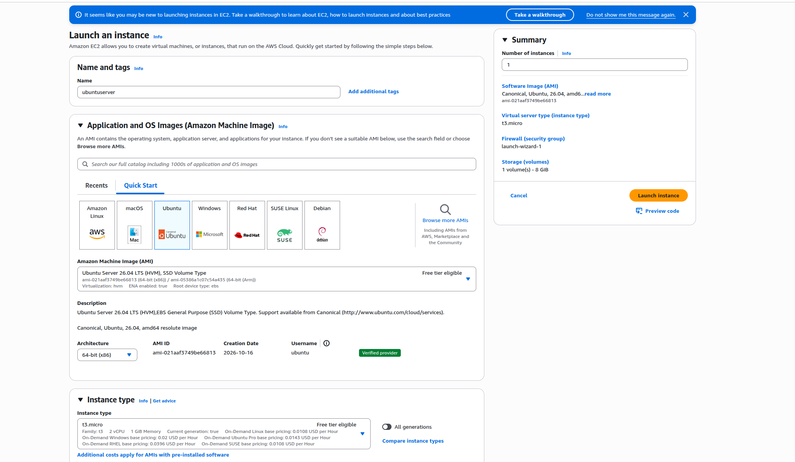
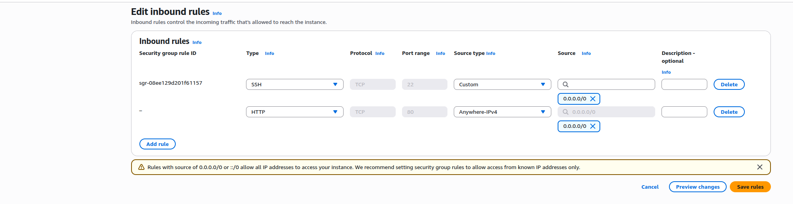
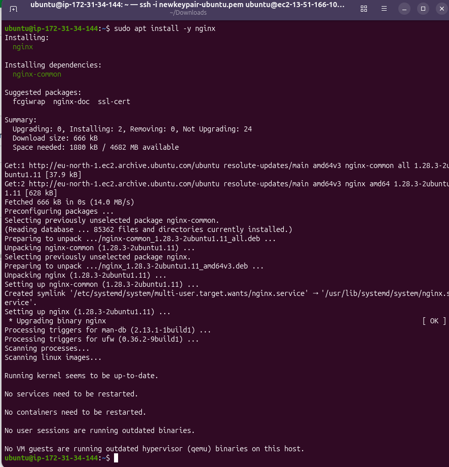
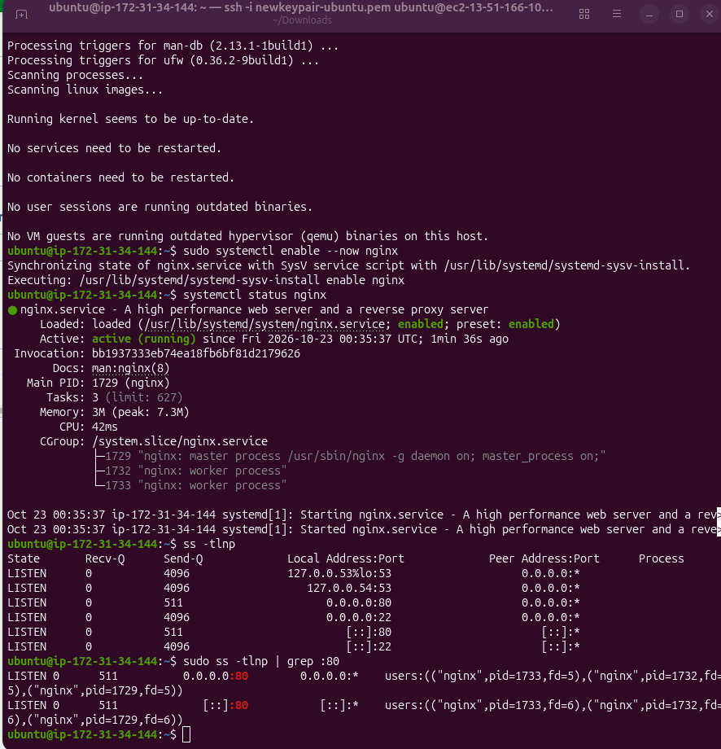
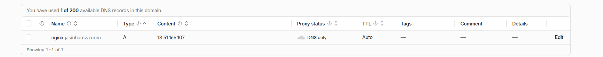
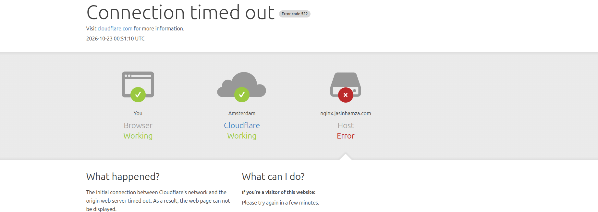
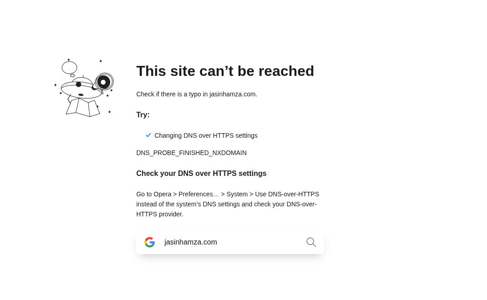
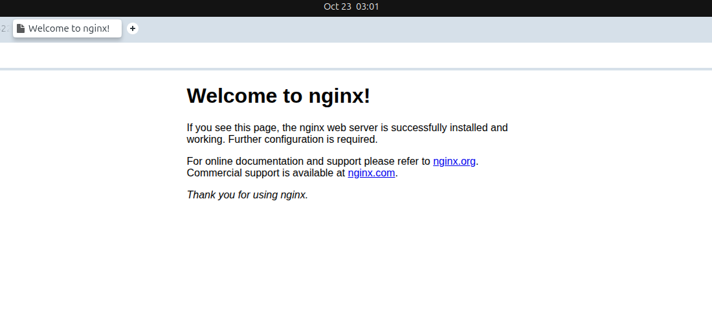

# Networking assignment: Domain to NGINX

## Goal : Buy a domain, deploy NGINX on an EC2 instance, and make the page load over your own domain.

## Step 1

1. Step one was to buy the domain. I chose to buy my domain through Cloudfare.
No specific reason except that i know that its cheap.

## Step 2

- Launching a EC2 instance.
- Creating a key pair and downloading it.

## Step 3

- Changing security settings to allow HTTP from port 80.

## Step 4

- SSHing into the newly created instance.
- Downloading NGINX on the server.

## Step 5

- Starting NGINX on the server and making it start everytime the server boots via "sudo systemctl enable --now nginx".
- Health check, a check to see that nginx is active and running.
- ss -tlnp. are the ports listening.

## Step 6 - Configuring a DNS

- Adding a record to the domain.
- A type and providing the public IPV4 adress.
- Turning proxy off (which i did not do at first :()

## Step 7 - First challenge

- I couldnt access the website. Error code 522 even though the DNS record was correct.
- After some trials and errors i found out the proxy was still on
- Turn the proxy off and it should work right?
- But that was not the case

- Trying to access the website again and now i get another error code
- It times out

- My browser automatically was trying to join through HTTPS but only HTTP was set up through port 80.
- I typed (http://nginx.jasinhamza.com)
- And finally after some hours of trials and tribulations everything worked!

